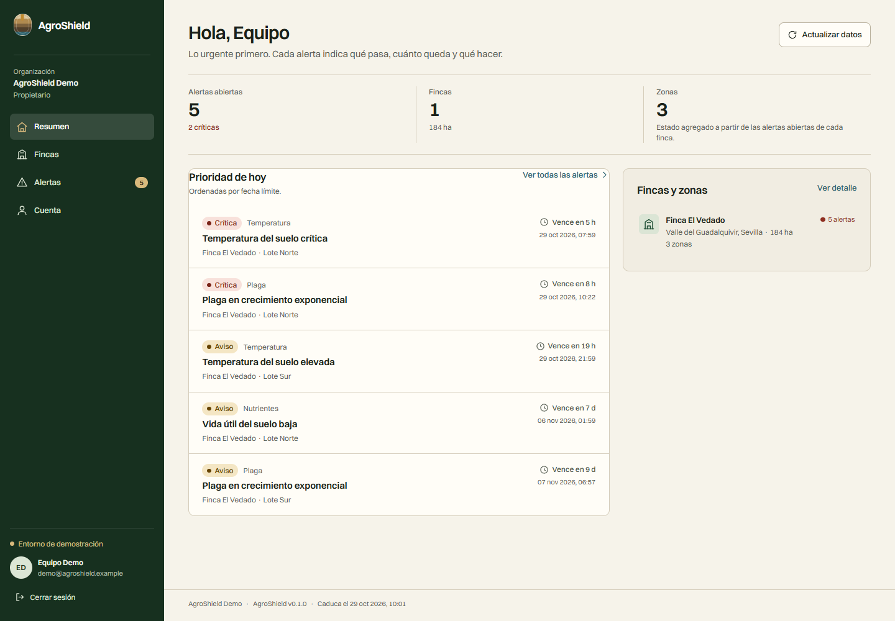
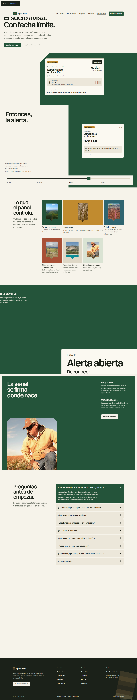

# Documentación — AgroShield

[](https://github.com/Zatrynox/agroshield-docs/actions/workflows/ci.yml)

Diseño, QA, checklist de lanzamiento y estado reanudable de AgroShield `0.1.0`. Esta documentación describe lo que está implementado y verificado, y separa explícitamente lo que sigue pendiente.

> **Repositorio de documentación.** Se extrae del monorepo [`Zatrynox/agroshield`](https://github.com/Zatrynox/agroshield), que sigue siendo la fuente de verdad. El código vive en [`agroshield-backend`](https://github.com/Zatrynox/agroshield-backend), [`agroshield-frontend`](https://github.com/Zatrynox/agroshield-frontend), [`agroshield-landing`](https://github.com/Zatrynox/agroshield-landing), [`agroshield-design-tokens`](https://github.com/Zatrynox/agroshield-design-tokens) y [`agroshield-infra`](https://github.com/Zatrynox/agroshield-infra).

## Índice

| Documento | Contenido |
| --- | --- |
| [Checklist de lanzamiento](launch-checklist.md) | Qué falta para pasar de la demo a producción: legal, secretos, TLS, backups y operación. |
| [Sistema de diseño](design/DESIGN.md) | Dirección visual, tipografía, paleta, componentes y reglas de accesibilidad. |
| [Dirección creativa](design/direccion-taste.md) | Notas originales de la dirección de arte (la versión legible es `DESIGN.md`). |
| [Informe de QA](qa/qa-report.md) | Typecheck, 77 pruebas, smoke, UI QA, axe y Lighthouse. |
| [Estado pendiente](status/PENDING.md) | Registro reanudable con lo verificado, lo bloqueado y los siguientes pasos. |
| [Evidencias de diseño](design/evidencia/) | Capturas de la landing y el panel en escritorio y 320 px. |
| [Resultados de QA](qa/) | JSON de Lighthouse, axe, UI QA y comprobación de enlaces. |

## Estado verificado

| Comprobación | Resultado |
| --- | --- |
| Typecheck, lint y build | Pasan en el monorepo y en los repositorios extraídos |
| Pruebas automatizadas | **77/77** (41 backend, 13 frontend, 23 landing) |
| CI en GitHub Actions | **4/4 jobs en verde** (run `41223672231`, 2026-10-31) |
| Imágenes Docker | Backend y web construidas; Trivy 0 HIGH/CRITICAL corregibles |
| Gitleaks | Sin hallazgos en working tree e historial |
| Stack local | `http://localhost:8088`, smoke de API 23/23 |
| Stack de producción | **No ejecutado**: requiere dominio, TLS, secretos e identidad legal |

## Capturas





## Verificación de enlaces

```bash
node scripts/check-docs-links.mjs
```

El script comprueba que todos los enlaces e imágenes relativos del repositorio resuelven. No descarga URLs externas.

## Licencia

Sin licencia concedida todavía. La documentación se publica para revisión; no se autoriza su reutilización fuera de AgroShield hasta que se defina una licencia.
